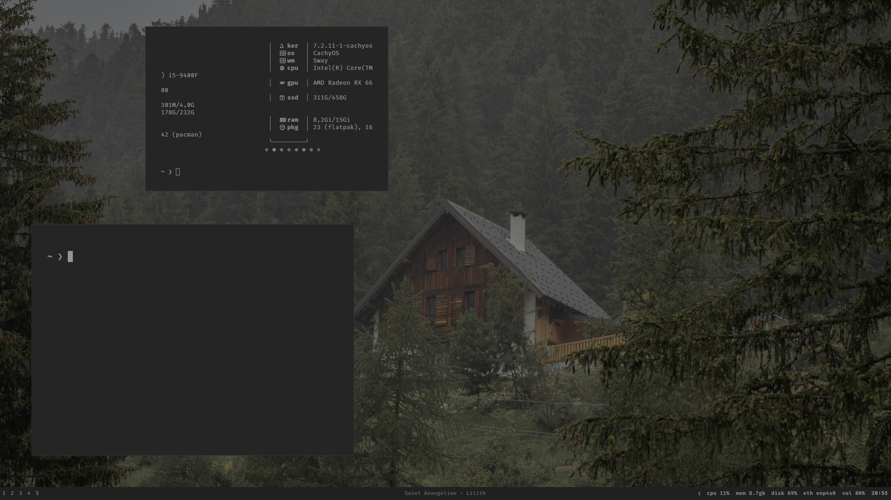

# Arch + Sway

My current desktop, built on CachyOS (Arch-based). A forest wallpaper, dark
terminals, small borders, and a quiet bar. Mostly a place to work and learn.



[Clean desktop, without the bar](screenshots/desktop-clean.png)

## What's here

| Component | Setup |
| --- | --- |
| Compositor | Sway; 1px borders, 10px inner gaps |
| Terminal | Foot; FiraCode Nerd Font, low-saturation ANSI palette |
| Launcher | Rofi; dark theme with app icons |
| Bar | Waybar; bottom, Inter font, workspaces and system stats |
| Notifications | SwayNotificationCenter (upstream defaults) |
| Wallpapers | wpaperd + wpaperctl when available; Sway/swaybg fallback |
| Screenshots | grim + slurp + wl-clipboard |
| Keyboard | US / Georgian; Super+Space switches layouts |

This installs desktop dotfiles onto an existing Arch installation. It does not
install Arch itself, GPU drivers, or a display manager. Install as your regular
user. The installer never runs automatically after cloning.

## Install

```bash
git clone https://github.com/Nadirashvil1/dotfiles_sway.git
cd dotfiles_sway
bash install.sh --dry-run
bash install.sh
```

The installer shows its plan, asks before proceeding, then uses
`sudo pacman -Syu --needed` for the required packages. Pacman keeps its own
confirmation. A full system upgrade avoids partial upgrades.

Existing Sway, Foot, Rofi, Waybar, and wpaperd config directories are moved into
unique backups under `~/.local/state/sway-rice/backups/`. Symlinks are preserved
as symlinks. Only the named helper scripts are replaced under
`~/.local/bin/sway-rice/`; unrelated scripts and shell settings stay in place.
A Sway-specific portal preference file is installed for screen sharing and GTK
file dialogs; other desktops' portal preferences are preserved.
Installation does not reload your running desktop, enable services, change your
login shell, or modify your display manager.

After installation, put images you want to use in `~/Pictures/Wallpapers/` and
start a new Sway session from your existing login manager, or run `sway` from a
TTY. With no images, Sway uses a plain dark background. Wallpaper files are not
bundled; the screenshots show my personal selection.

### Options

```bash
# Install configs only (dependencies must already be installed).
bash install.sh --no-packages

# Also compile the same wpaperd + wpaperctl revision used by my setup.
bash install.sh --build-wallpaper-tools

# Show the plan without installing, building, or writing anything.
bash install.sh --dry-run

# Install into a disposable directory, without touching your own desktop.
bash install.sh --no-packages --yes --target-home /tmp/sway-rice-preview
```

The optional build fetches upstream wpaperd at
`483225a9c6ad4f9bbf9104f958eafee9c47d4612`, builds with Cargo's locked dependency
versions, and installs both tools in `~/.local/bin/sway-rice/tools/`.
It requires internet access and Rust build dependencies; builds happen before
configuration deployment. The default installation does not compile anything.
Without both wallpaper tools, the helper uses Sway/swaybg and still supports
next/previous wallpaper shortcuts.

## Keys

`Mod` means **Alt**, matching my current setup.

| Shortcut | Action |
| --- | --- |
| Alt+Enter | Foot terminal |
| Alt+p or Alt+d | Rofi launcher |
| Alt+e | Thunar file manager |
| Alt+q | Close window |
| Alt+h/j/k/l or arrow keys | Focus a window |
| Alt+Shift+h/j/k/l | Move a window |
| Alt+1–0 | Switch workspace |
| Alt+Shift+1–0 | Move window to workspace |
| Alt+f | Fullscreen |
| Alt+Shift+Space | Toggle floating |
| Alt+r | Resize mode; Escape exits |
| Alt+i | Toggle Waybar |
| Alt+= / Alt+- | Next / previous wallpaper |
| Alt+Shift+c | Reload Sway config |
| Alt+Shift+l | Lock the session |
| Print or Alt+Shift+s | Select screenshot area and copy |
| Alt+Print or Shift+Print | Copy focused display screenshot |
| Ctrl+Print | Select, save, and copy screenshot |
| Super+Space | Toggle US / Georgian keyboard layout |

Screenshots are saved in `~/Pictures/Screenshots` unless `XDG_PICTURES_DIR` is
set in the environment. Optional screenshot editing uses Satty or Swappy if
installed. Screen recording tools are not included in this snapshot.

## Personalize

- **Monitor:** edit `~/.config/sway/config.d/outputs.conf`. My DP-2, 220Hz, HDR
  settings are left as a comment; no display mode is forced on another machine.
- **Keyboard:** edit the `input type:keyboard` block in the Sway config.
- **Wallpaper:** add PNG, JPEG, or WebP files to `~/Pictures/Wallpapers/`.
  Change the path in the wallpaper helper and wpaperd config if needed.
- **Terminal and launcher:** edit `~/.config/foot/foot.ini` and
  `~/.config/rofi/config.rasi`.
- **Bar:** edit `~/.config/waybar/config.jsonc` and `style.css`.
- **Session locking:** the lock shortcut is included; automatic idle locking
  is left for you to configure.

The screenshot's system-info output and shell prompt belong to my personal
shell setup; this repository does not change your shell or install prompt
frameworks. Some screenshot hardware/output details will naturally differ.

## Backups and recovery

The installer prints the exact backup directory. Its paths mirror your home:
for example, `.config/sway` contains your previous Sway config or symlink.
To restore a component, move the installed directory aside and move its matching
backup back to the original path. Do not restore while the installer is running.
Keep the backup until you are satisfied with the new setup.

An interrupted installation can leave a mix of old and new configs. Originals
already moved are retained in that run's backup; resolve the error and either
restore those components or rerun the installer. Each run uses a different backup.

## Checks

```bash
python3 -m unittest discover -s tests -v
for script in install.sh scripts/*; do bash -n "$script"; done
```

Tests deploy only into temporary directories and never call pacman, build
packages, or reload Sway. A full desktop install must be checked in a separate
Arch session or VM.

## Credits

See [ATTRIBUTION.md](ATTRIBUTION.md) and [LICENSES](LICENSES/) for the original
configuration authors and retained licenses.
